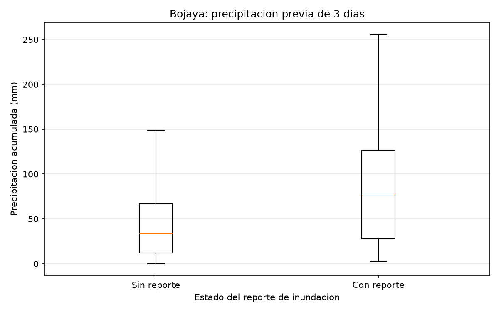
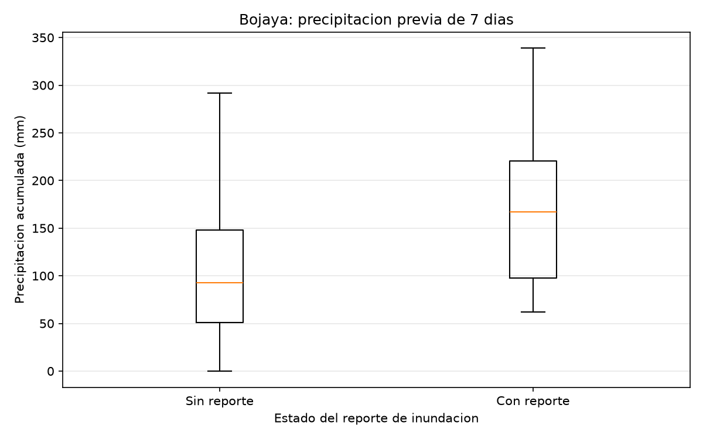
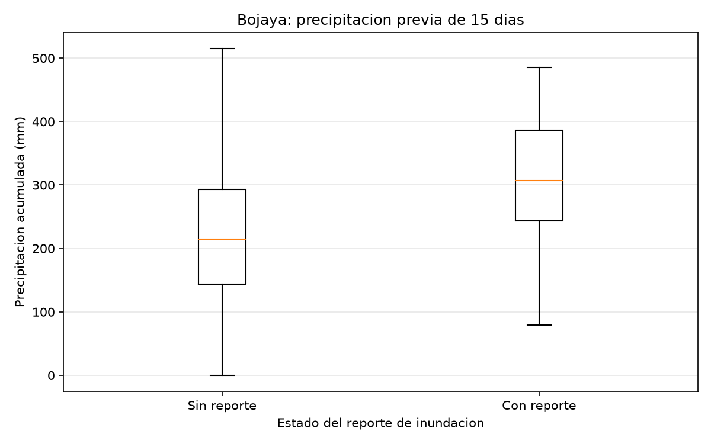

# 🌧️ AlertaChoco-AI
### Sistema de análisis de inundaciones en el departamento del Chocó mediante ciencia de datos e inteligencia artificial

**Desarrollador:** Daniel Mauricio Guerrero Rengifo  
**Profesión:** Ingeniero de Sistemas  
**Estado:** En desarrollo — Análisis exploratorio y construcción del panel interactivo  
**Ubicación del estudio:** Chocó, Colombia

---

## 📌 1. Descripción del proyecto

**AlertaChoco-AI** es un proyecto de investigación y desarrollo tecnológico que busca analizar el comportamiento histórico de las inundaciones en el departamento del Chocó, Colombia, mediante herramientas de ciencia de datos, análisis estadístico y programación en Python.

El proyecto integra información oficial de emergencias y precipitaciones con el propósito de identificar patrones asociados a eventos de inundación, evaluar la calidad de los datos y determinar la viabilidad de desarrollar modelos de aprendizaje automático.

Actualmente se ha realizado un análisis departamental de registros históricos de inundaciones y un estudio experimental enfocado en el municipio de Bojayá, utilizando información meteorológica de las estaciones Bellavista y Opogadó.

El propósito final es construir una herramienta interactiva que facilite la consulta, exploración e interpretación de información relacionada con las inundaciones en el Chocó.

## 🌎 2. Planteamiento del problema

El departamento del Chocó presenta condiciones geográficas, climáticas e hidrológicas que lo hacen vulnerable a las inundaciones.

Las precipitaciones frecuentes, la presencia de numerosos ríos y las características de diferentes asentamientos humanos hacen necesario contar con herramientas que permitan estudiar estos fenómenos.

Aunque existen fuentes oficiales de información, los registros meteorológicos y los reportes de emergencias se encuentran en conjuntos de datos diferentes, lo que dificulta su análisis conjunto.

AlertaChoco-AI busca contribuir a resolver esta dificultad mediante la integración, procesamiento y visualización de datos históricos.

## 🎯 3. Objetivos

### Objetivo general

Desarrollar un sistema de análisis de información histórica de precipitaciones e inundaciones en el departamento del Chocó, mediante técnicas de ciencia de datos, que permita identificar patrones relevantes y evaluar la viabilidad de implementar modelos predictivos de riesgo.

### Objetivos específicos

1. Recopilar información oficial sobre precipitaciones e inundaciones.
2. Evaluar la calidad y consistencia de los conjuntos de datos.
3. Implementar procesos de limpieza, transformación y organización.
4. Relacionar los registros de inundación con las precipitaciones históricas.
5. Calcular indicadores meteorológicos de lluvia acumulada.
6. Realizar análisis estadísticos y visualizaciones.
7. Evaluar la viabilidad de utilizar aprendizaje automático.
8. Desarrollar un panel interactivo para consultar los resultados.

## 🗂️ 4. Fuentes de información

### Unidad Nacional para la Gestión del Riesgo de Desastres (UNGRD)

Se utiliza información histórica de emergencias para identificar fechas, municipios y afectaciones relacionadas con inundaciones.

### Instituto de Hidrología, Meteorología y Estudios Ambientales (IDEAM)

Se utilizan datos históricos de precipitación de estaciones meteorológicas, incluyendo:

| Estación | Código | Municipio de referencia |
|---|---|---|
| Aeropuerto El Caraño | 11045010 | Quibdó |
| Bellavista | 11080010 | Bojayá |
| Opogadó | 11090010 | Bojayá |

Estas fuentes permiten desarrollar análisis exploratorios de la relación temporal entre las lluvias y las inundaciones reportadas.

## 🛠️ 5. Tecnologías utilizadas

| Tecnología | Aplicación |
|---|---|
| Python | Programación y procesamiento de datos |
| Pandas | Limpieza, transformación y análisis |
| NumPy | Operaciones numéricas |
| Matplotlib | Visualización estadística |
| Git | Control de versiones |
| GitHub | Repositorio y documentación |
| GitHub Codespaces | Entorno de desarrollo |
| Streamlit | Desarrollo del futuro panel interactivo |

## 🏗️ 6. Estructura del proyecto

```text
AlertaChoco-AI/
│
├── data/
│   ├── raw/
│   │   └── Datos originales de UNGRD e IDEAM
│   │
│   └── processed/
│       └── Datos limpios y procesados
│
├── src/
│   └── Programas Python del proyecto
│
├── reports/
│   └── figures/
│       └── Gráficos y visualizaciones
│
├── .gitignore
└── README.md
```

Esta organización permite separar los datos originales de los resultados del procesamiento y facilita la reproducibilidad de los análisis.

## 🔬 7. Metodología implementada

El desarrollo se ha organizado en las siguientes etapas:

**Etapa 1. Recolección:** obtención de datos oficiales de la UNGRD y del IDEAM.

**Etapa 2. Exploración:** revisión de columnas, tipos de datos, valores faltantes y registros duplicados.

**Etapa 3. Limpieza:** transformación de fechas, normalización de campos y preparación de información relevante.

**Etapa 4. Integración:** relación entre fechas de inundaciones y mediciones meteorológicas.

**Etapa 5. Ingeniería de características:** cálculo de precipitaciones acumuladas durante los 3, 7 y 15 días anteriores a cada observación.

**Etapa 6. Análisis estadístico:** comparación de distribuciones de lluvia y evaluación exploratoria de umbrales.

**Etapa 7. Evaluación de IA:** identificación de limitaciones relacionadas con el número de eventos, calidad de etiquetas y disponibilidad de variables.

**Etapa 8. Visualización interactiva:** desarrollo previsto del panel web con Streamlit.

## 📊 8. Resultados del análisis departamental

Durante el procesamiento de los registros de inundaciones del Chocó se obtuvieron:

| Indicador | Resultado |
|---|---:|
| Registros consolidados de inundaciones | 377 |
| Municipios identificados | 31 |
| Fechas distintas con reportes | 147 |
| Combinaciones únicas de municipio y fecha | 229 |

Estos resultados constituyen una base para estudiar la distribución territorial y temporal de las inundaciones reportadas.

Las combinaciones municipio-fecha no deben interpretarse automáticamente como eventos independientes.

## 🌧️ 9. Análisis experimental de Bojayá

Se seleccionó Bojayá como municipio de estudio para evaluar la relación entre las precipitaciones y las inundaciones históricas.

Se procesaron datos de Bellavista y Opogadó correspondientes al periodo 2019–2025.

### Disponibilidad meteorológica

| Indicador | Bellavista | Opogadó |
|---|---:|---:|
| Días del calendario analizado | 2.557 | 2.551 |
| Días con acumulados completos de 3, 7 y 15 días | 2.495 | 947 |
| Cobertura de las tres variables | 97,6 % | 37,1 % |

Bellavista presentó mayor continuidad de datos para las variables analizadas.

Por esta razón se seleccionó como estación principal para el conjunto de datos experimental inicial, sin asumir que representa todas las condiciones meteorológicas del municipio.

## 📈 10. Dataset experimental

Se construyó el archivo:

`data/processed/dataset_experimental_bojaya.csv`

Este conjunto contiene:

| Indicador | Resultado |
|---|---:|
| Observaciones | 2.495 |
| Fechas con inundación reportada | 14 |
| Días sin reporte registrado | 2.481 |
| Proporción de fechas con reporte | 0,56 % |

### Variables principales

- `Fecha`: fecha de observación.
- `LLUVIA_PREVIA_3_DIAS`: precipitación acumulada durante los tres días anteriores.
- `LLUVIA_PREVIA_7_DIAS`: precipitación acumulada durante los siete días anteriores.
- `LLUVIA_PREVIA_15_DIAS`: precipitación acumulada durante los quince días anteriores.
- `INUNDACION_REPORTADA`: indicador de existencia de reporte histórico de inundación.

El valor cero de esta última variable indica ausencia de reporte en el conjunto de datos, no ausencia verificada de inundación.

## 📉 11. Hallazgos estadísticos

El análisis exploratorio identificó diferencias entre las precipitaciones anteriores a fechas con reportes de inundación y las registradas en otros días.

Para la lluvia acumulada de 15 días se obtuvieron:

| Indicador | Sin reporte | Con reporte |
|---|---:|---:|
| Mediana | 215 mm | 307 mm |
| Percentil 75 | 293 mm | 386 mm |
| Percentil 90 | 374 mm | 465,8 mm |

La diferencia entre medianas fue de 92 mm.

Estos resultados sugieren una asociación estadística que merece ser investigada, pero no demuestran causalidad ni capacidad predictiva.

### Evaluación exploratoria de umbrales

Se calcularon umbrales basados en percentiles de precipitación.

Por ejemplo, un umbral de 295 mm acumulados durante 15 días fue superado en 8 de las 14 fechas con inundación reportada.

Sin embargo, también se superó en numerosos días sin reporte, por lo que no puede considerarse una alerta validada.

## 📊 12. Visualizaciones generadas

Se desarrollaron gráficos comparativos de precipitación acumulada para periodos de 3, 7 y 15 días.







Estas visualizaciones facilitan la interpretación de los resultados y constituyen una base para el futuro panel interactivo.

## 🧠 13. Evaluación de viabilidad de inteligencia artificial

La evaluación técnica identificó limitaciones relevantes:

- Solo se dispone de 14 fechas con inundación reportada para el estudio experimental de Bojayá.
- Existe un fuerte desbalance entre fechas con reporte y fechas sin reporte.
- No se cuenta con confirmación de ausencia de inundaciones en los días sin reporte.
- La disponibilidad meteorológica varía entre estaciones.
- Es necesario incorporar otras variables, especialmente niveles de los ríos.
- Se requiere una validación temporal y geográfica adecuada.

### Decisión técnica

Actualmente no se considera apropiado presentar un modelo supervisado como un sistema predictivo confiable.

La prioridad es ampliar y validar la información antes de desarrollar modelos destinados a identificar riesgos futuros.

Mientras tanto, el proyecto continuará como una herramienta de análisis histórico y exploratorio.

## 💻 14. Ejecución de los análisis

### Requisitos

- Python 3.
- Pandas.
- NumPy.
- Matplotlib.

### Instalación de dependencias

Desde la carpeta principal del proyecto:

```bash
python3 -m pip install pandas numpy matplotlib streamlit
```

### Ejemplos de ejecución

Validar datos de Bellavista:

```bash
python3 src/analizar_precipitaciones_bellavista.py
```

Preparar datos de Bellavista:

```bash
python3 src/preparar_precipitaciones_bellavista.py
```

Preparar datos de Opogadó:

```bash
python3 src/preparar_precipitaciones_opogado.py
```

Construir el dataset experimental:

```bash
python3 src/crear_dataset_experimental.py
```

Analizar patrones de lluvia:

```bash
python3 src/analizar_patrones_lluvia.py
```

Generar gráficos:

```bash
python3 src/graficar_patrones_lluvia.py
```

Evaluar umbrales exploratorios:

```bash
python3 src/evaluar_umbrales_lluvia.py
```

Evaluar viabilidad de IA:

```bash
python3 src/evaluar_viabilidad_ia.py
```

**Nota:** algunos programas dependen de archivos procesados previamente. Para reproducir el proyecto desde cero es necesario ejecutar primero las etapas de preparación e integración correspondientes.

## 🚀 15. Próximas etapas

El desarrollo continuará con:

1. Construcción del panel interactivo utilizando Streamlit.
2. Integración de gráficos y estadísticas.
3. Visualización de precipitaciones y registros históricos.
4. Ampliación de datos meteorológicos a otros municipios.
5. Incorporación de información hidrológica adicional.
6. Revisión de la calidad de las etiquetas históricas.
7. Evaluación de modelos experimentales cuando existan datos suficientes.
8. Documentación técnica y pruebas finales.

## ⚠️ 16. Limitaciones y uso responsable

AlertaChoco-AI es un proyecto académico y tecnológico en desarrollo.

Sus resultados son exploratorios y no constituyen pronósticos oficiales, alertas tempranas validadas ni recomendaciones operativas para situaciones de emergencia.

Cualquier implementación predictiva futura requerirá evaluaciones adicionales de calidad, desempeño y confiabilidad.

## 👨‍💻 17. Autor

**Daniel Mauricio Guerrero Rengifo**  
Ingeniero de Sistemas

**Proyecto:** AlertaChoco-AI  
**Área:** Ciencia de datos, análisis estadístico e inteligencia artificial aplicada a inundaciones.

**Repositorio:** https://github.com/dmgr08052/AlertaChoco-AI

---

*AlertaChoco-AI: transformando datos históricos en conocimiento para comprender mejor los riesgos de inundación en el Chocó.*
